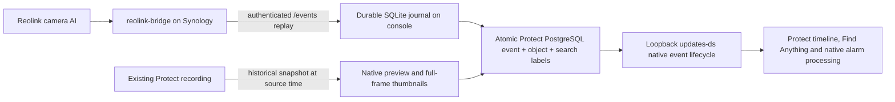

# Reolink Protect Events

Imports **real camera AI classifications** from [reolink-bridge](https://github.com/volatile1990/reolink-bridge) as native UniFi Protect detections on the existing camera IDs. `people` becomes `person`, `car` becomes `vehicle`, and `dog_cat` becomes `animal`. Ordinary motion never becomes a person detection. No local image AI runs.

An optional, explicitly mapped [Frigate source](docs/frigate-union.md) can contribute
confirmed object detections through a private authenticated HTTP projection.
Its intervals are united with Reolink by camera, class and overlapping time.
Each source retains its own clears, replay state and timeout. Classification
origin is recorded as camera, external model or mixed; this service still runs
no image inference. Omitting the `frigate` configuration retains the original
Reolink collection path for every camera.

This implementation is pinned to **Protect 7.3.70** and its shipped UI **7.3.26**. It uses private console internals because Protect's published integration API does not provide Smart Detection ingestion. A version/schema mismatch stops native delivery while the source journal keeps collecting; applying the frontend patch additionally requires the exact known UI hashes. Supporting another Protect release requires inspecting and testing that release.

## Data flow



The collector runs on the Protect console to keep PostgreSQL and the DS WebSocket on loopback. The video bridges remain on Synology. No database port is exposed and no camera is re-adopted.

For outdoor cameras configure the bridge's `onvif.motion_event_policy` as `none`: source AI detections still arrive in `/events`, while generic ONVIF motion stays closed. For the indoor camera keep `all`. `classified` is a useful intermediate rollout setting, but it still generates generic motion for classified outdoor detections.

## Detection contract

| Camera source | Protect class |
|---|---|
| people, person, human, pedestrian | person |
| car, vehicle | vehicle |
| dog_cat, dogcat, animal, pet, dog, cat | animal |
| cry, baby_cry, babycry | native audio classification alrmBabyCry |
| plain motion, face, visitor, unknown AI types | no invented supported class; original source fields remain in the journal |

Version 1.4 also imports the selected Frigate audio labels as native
`smartAudioDetect` events and retains supported vehicle and animal details on
existing visual events. Audio has no visual integration zone, object or spatial
track. See [the source contract](docs/frigate-union.md) for exact mappings and
the supported rollback boundary.

Repeated pushes extend the same class interval. Clear pushes close it. Camera reconnects, bridge restarts, replay gaps and the configured stale timeout close the previous interval with an explicit reason. Simultaneous different classes get separate native intervals. Timestamps refer to the bridge's UTC receipt of the camera push, retaining the original .NET timestamp in provenance.

The camera does not supply confidence, object coordinates, embeddings or spatial tracks through this bridge. Those fields are omitted. Protect's native search accepts unknown confidence, including with its default 30% filter. Thumbnails show the recorded full frame, without fabricated boxes. Zone 1 is explicitly an adapter integration rule covering the whole camera, not a claim about a Reolink spatial zone. Facial identification, license plate attributes, re-identification and line crossing are outside this source contract.

Protect's timeline preview and full-frame view use separate thumbnail lookups. Each imported snapshot therefore has two independent thumbnail IDs linked to the same event: a default preview row (`isFullfov=NULL`, accepted by Protect as the standard preview) and a full-frame row (`isFullfov=true`). Both retain the same recorded full-frame JPEG and its actual dimensions. The preview row does not claim a detected object crop; Protect can fit the full frame into its small timeline tile. `events.thumbnailId` references the preview, while `events.thumbnailFullfovId` references the full frame. Find Anything's `detectedThumbnails[].croppedId` remains a reference to the recorded image, without invented spatial coordinates.

## Deployment

Python 3.9+ is required. Automatic preview selection uses Pillow; the deployment
package includes a verified release-local ARM64 decoder without installing global
packages on the console. The console requires local Protect PostgreSQL access
through `runuser -u postgres`, an adopted camera MAC for each loopback `updates-ds`
connection, and systemd. See [automatic previews](docs/automatic-thumbnails.md) and
[automatic own-code releases and the media monitor](docs/operations-and-releases.md).

Offline contracts run on Linux and Windows in CI with Python 3.9, 3.13 and
3.14. A separate CI job runs the actual native transactions in an isolated
PostgreSQL 16 container, using synthetic fixtures modeled on the inspected
Protect schema. Locally, pull `postgres:16` explicitly, then run
`python tools/test_postgres.py`. The runner publishes no ports, mounts no host
directories, applies resource limits and removes only its own labeled temporary
container. Its database marker prevents loading destructive fixtures into an
unmarked database. These tests verify SQL and concurrency; they do not emulate
Protect's application alarm handlers or prove compatibility with another release.

The provided deployment tools use a trusted SSH alias (default `unifi-dream-machine`) and the existing private console configuration at `/data/reolink-bridge-events/config.json`. Bridge credentials remain on the console, are copied only to a root-owned mode-0600 configuration, and never enter command arguments, Git or output. Configure your SSH alias beforehand; these tools do not install keys or change host trust. The current deployment helper deliberately checks the six-camera scope `192.168.30.210` through `.215`; adapt and review that explicit scope for another installation.

```console
python -m unittest discover -s tests
python tools/deploy.py capture
python tools/enable_features.py plan
python tools/enable_features.py apply
python tools/enable_features.py restart
python tools/deploy.py install
python tools/deploy.py status
```

Enable `none` on outdoor bridges **after** verifying the native path. The feature setup backs up and changes only the selected cameras' `featureFlags`, whole-frame `smartDetectZones` integration rule and a camera-selection predicate in the two exact shipped frontend files. Existing `smartDetectSettings` and the UniFi AI user agreement remain unchanged: classification comes from Reolink. It does not advertise AI Port pairing or full camera features. Protect needs one restart to reload persisted camera fields. The backend service file is not patched. `refresh` only checks that the persisted fields are loaded.

Persistent deployment directory: `/data/reolink-protect-events`. Service: `reolink-protect-native-events.service`. Releases are addressed by package hash. The SQLite source journal, outbox and retry state survive service restarts. `health.json` distinguishes healthy capture from healthy native delivery and includes per-camera poll health, import retries, replay gaps and thumbnail failures.

Version 1.1 separates collection from native delivery. A persistent network pool
collects bridge pushes; a dedicated outbox thread owns a separate SQLite WAL
connection, PostgreSQL adapter and DS clients. A slow schema check, import or
recorded snapshot cannot stop collection. HTTP headers and bodies and DS
handshakes have total deadlines. SQLite upgrades add retry fields and partial
indexes without replacing existing state. Native delivery still has the
documented at-least-once notification boundary.

Health includes `captureHealthy`, per-camera poll duration, replay backlog and
remaining replay headroom, oldest pending-event age, persistent import errors,
last successful native notification and grouped thumbnail error reasons. The
deployment status computes health freshness; an active process with an old
health file is unhealthy. `nativeWorkerAgeMs` reports a stalled native worker
independently of continuing source capture. Missing historical pictures do not
make otherwise successful source/event delivery unhealthy.

The bridge may optionally return current `source.connectionEpoch` and
`source.connected` alongside its replay. Once that replay has been consumed, the
collector closes a prior interval at a disconnect/reconnect even without a new
camera push. Older bridges remain supported through event epochs and stale
timeouts. During paginated catch-up, current connection state and wall-clock
expiry wait for the remaining historical pushes. A backwards source-clock jump
preserves every original timestamp, advances the cursor, marks provenance and
keeps interval progress monotonic. A clear received before the latest observed
activity has an explicitly estimated end.

The feature helper ships the narrow Controls layer reversal contract inside
this package; no sibling repository is needed. Rollback persists its UI/camera
phase before writes. After a database failure or interrupted rollback, repeat
`python tools/enable_features.py rollback` to resume. Every repeated phase
checks file ownership/hash or camera compare-and-swap conditions. `status`
reports a partial rollback and its resume command. Controls must still be
removed first, and unrelated file or camera edits still stop restoration.

An optional read-only check for a **real** already imported event verifies its class filters, graph, both thumbnail paths, track response and selected camera flags:

```console
python tools/verify_native.py --event-id YOUR_NATIVE_EVENT_ID --camera-id YOUR_CAMERA_ID
```

Use `--expected-class animal` or `--expected-class vehicle` for a corresponding real camera detection; the default is `person`. The check requires HTTP 200 and a non-empty JPEG with positive image dimensions from `/api/events/<id>/thumbnail?w=48&h=48`, the same path with `isFullfov=false`, and `/api/events/<id>/thumbnail?isFullfov=true`. The JSON fields `timelineThumbnailApi` and `timelineThumbnailExplicitApi` report the standard previews; the existing `thumbnailApi` field continues to report the full-frame image. The tool saves no images and performs only API GET requests and database read-only queries. Protect may populate its own thumbnail cache when serving a GET.

Never publish credentials, camera images, recordings, the SQLite journal or full console/bootstrap responses. Synthetic fixtures in `tests/` are offline only; production validation must use independently verified camera-originated evidence.

## Recovery and operational limits

`python tools/deploy.py rollback` restores the prior service/config release without replacing the journal. `python tools/enable_features.py rollback` restores the backed-up UI and camera fields only if ownership/hash/current-value checks still match; restart Protect afterward. Restore the prior outdoor bridge policies when reverting to a deployment without native imports. Existing recordings and operator favorites are never deleted by deployment.

For events imported before the separate timeline preview was added, review and apply the preview repair:

```console
python tools/repair_previews.py plan
python tools/repair_previews.py apply
```

The repair supplies the missing default preview from the existing recorded JPEG while preserving the full-frame thumbnail and source classification. Run `tools/verify_native.py` for a real affected event afterward to check both API image paths.

Missing recorded frames use a bounded exponential retry schedule (15 seconds
through one hour, at most 20 attempts), with sanitized persistent error reasons.
After fixing recording availability, review and reset attempts for explicit
previously delivered event IDs:

```console
python tools/retry_thumbnails.py plan --event-id YOUR_NATIVE_EVENT_ID
python tools/retry_thumbnails.py apply --event-id YOUR_NATIVE_EVENT_ID
```

`plan` opens the existing journal read-only. `apply` changes only failed/pending
media retry state; it keeps interval IDs and delivery revisions. A deleted or
purged Protect event remains protected by the existing-event guard. Completed
or retired media rows are not reopened. The native verifier returns individual
`checks` and `failedChecks`; success requires the supported version, bootstrap,
selected camera flags/zones, owned camera-AI graph, empty native tracks, both
class confidence filters and all three JPEG paths.

Native graph writes are transactional and use deterministic event IDs. A failed event retries with backoff without blocking other cameras. Delivery to the DS WebSocket has no application ACK: a crash after acceptance can repeat a notification or custom alarm action, although the stored event remains unique. Updates and late thumbnails do not resurrect events already purged or deleted by Protect. Imported graphs use Protect's existing retention/foreign-key relationships; the separate source journal retains 30 days.

The bridge's default memory replay retains 256 camera pushes and is lost on a
bridge restart. Recent bridges offer an opt-in durable replay with its own
capacity, byte and age limits; configure that on persistent storage for stronger
outage recovery. The collector fetches at most 256 pushes per page in both modes.
A long outage can still exceed retention. Replay gaps and the known number of
lost pushes are counted once; even an entirely expired empty replay advances
only to its proven retention floor. No implementation can reconstruct
classifications the camera/bridge no longer retains. Thumbnails retry
separately; a missing recording can leave an event without a picture. Package
upgrades are guarded rather than automatically patched or downgraded. Console
OS upgrades may require re-registering the systemd unit.

## Implementation references

The native protocol/schema was inspected against the installed Protect package. The independent [ubiquiti-protect-onvif-event-listener](https://github.com/danielwoz/ubiquiti-protect-onvif-event-listener/tree/c11f96d4ff984792805a8b88b31439e799bc3ca6) was a useful reference for the existence of native database import and frontend gates. This repository implements its own narrow Python adapter, without that project's motion-to-person fallback, local detector, fabricated confidence/boxes, hourly event cap or blanket UI-feature patches.
