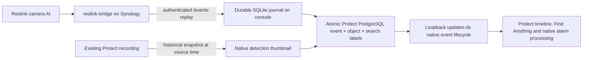

# Reolink Protect Events

Imports **real camera AI classifications** from [reolink-bridge](https://github.com/volatile1990/reolink-bridge) as native UniFi Protect detections on the existing camera IDs. `people` becomes `person`, `car` becomes `vehicle`, and `dog_cat` becomes `animal`. Ordinary motion never becomes a person detection. No local image AI runs.

This implementation is pinned to **Protect 7.3.70** and its shipped UI **7.3.26**. It uses private console internals because Protect's published integration API does not provide Smart Detection ingestion. A version/schema mismatch stops native delivery while the source journal keeps collecting; applying the frontend patch additionally requires the exact known UI hashes. Supporting another Protect release requires inspecting and testing that release.

## Data flow



The collector runs on the Protect console to keep PostgreSQL and the DS WebSocket on loopback. The video bridges remain on Synology. No database port is exposed and no camera is re-adopted.

For outdoor cameras configure the bridge's `onvif.motion_event_policy` as `none`: source AI detections still arrive in `/events`, while generic ONVIF motion stays closed. For the indoor camera keep `all`. `classified` is a useful intermediate rollout setting, but it still generates generic motion for classified outdoor detections.

## Detection contract

| Camera source | Protect class |
|---|---|
| people, person, human, pedestrian | person |
| car, vehicle | vehicle |
| dog_cat, dogcat, animal, pet, dog, cat | animal |
| plain motion, face, visitor, unknown AI types | no invented supported class; original source fields remain in the journal |

Repeated pushes extend the same class interval. Clear pushes close it. Camera reconnects, bridge restarts, replay gaps and the configured stale timeout close the previous interval with an explicit reason. Simultaneous different classes get separate native intervals. Timestamps refer to the bridge's UTC receipt of the camera push, retaining the original .NET timestamp in provenance.

The camera does not supply confidence, object coordinates, embeddings or spatial tracks through this bridge. Those fields are omitted. Protect's native search accepts unknown confidence, including with its default 30% filter. Thumbnails show the recorded full frame, without fabricated boxes. Zone 1 is explicitly an adapter integration rule covering the whole camera, not a claim about a Reolink spatial zone. Facial identification, license plate attributes, re-identification and line crossing are outside this source contract.

## Deployment

Python 3.9+ is sufficient; the runtime has no pip dependencies. The console requires local Protect PostgreSQL access through `runuser -u postgres`, an adopted camera MAC for each loopback `updates-ds` connection, and systemd.

The provided deployment tools use a trusted SSH alias (default `unifi-dream-machine`) and the existing private console configuration at `/data/reolink-bridge-events/config.json`. Bridge credentials remain on the console, are copied only to a root-owned mode-0600 configuration, and never enter command arguments, Git or output. Configure your SSH alias beforehand; these tools do not install keys or change host trust. The current deployment helper deliberately checks the six-camera scope `192.168.30.210` through `.215`; adapt and review that explicit scope for another installation.

```console
python -m unittest discover -s tests
python tools/deploy.py capture
python tools/enable_features.py plan
python tools/enable_features.py apply
python tools/enable_features.py restart
python tools/deploy.py install
python tools/deploy.py status
```

Enable `none` on outdoor bridges **after** verifying the native path. The feature setup backs up and changes only the selected cameras' `featureFlags`, whole-frame `smartDetectZones` integration rule and a camera-selection predicate in the two exact shipped frontend files. Existing `smartDetectSettings` and the UniFi AI user agreement remain unchanged: classification comes from Reolink. It does not advertise AI Port pairing or full camera features. Protect needs one restart to reload persisted camera fields. The backend service file is not patched. `refresh` only checks that the persisted fields are loaded.

Persistent deployment directory: `/data/reolink-protect-events`. Service: `reolink-protect-native-events.service`. Releases are addressed by package hash. The SQLite source journal, outbox and retry state survive service restarts. `health.json` distinguishes healthy capture from healthy native delivery and includes per-camera poll health, import retries, replay gaps and thumbnail failures.

An optional read-only check for a **real** already imported event verifies its class filters, graph, thumbnail, track response and selected camera flags:

```console
python tools/verify_native.py --event-id YOUR_NATIVE_EVENT_ID --camera-id YOUR_CAMERA_ID
```

Never publish credentials, camera images, recordings, the SQLite journal or full console/bootstrap responses. Synthetic fixtures in `tests/` are offline only; production validation must use independently verified camera-originated evidence.

## Recovery and operational limits

`python tools/deploy.py rollback` restores the prior service/config release without replacing the journal. `python tools/enable_features.py rollback` restores the backed-up UI and camera fields only if ownership/hash/current-value checks still match; restart Protect afterward. Restore the prior outdoor bridge policies when reverting to a deployment without native imports. Existing recordings and operator favorites are never deleted by deployment.

Native graph writes are transactional and use deterministic event IDs. A failed event retries with backoff without blocking other cameras. Delivery to the DS WebSocket has no application ACK: a crash after acceptance can repeat a notification or custom alarm action, although the stored event remains unique. Updates and late thumbnails do not resurrect events already purged or deleted by Protect. Imported graphs use Protect's existing retention/foreign-key relationships; the separate source journal retains 30 days.

The bridge's replay is bounded to 256 camera pushes. A long collector outage or a bridge restart can therefore lose events that were never journaled. Replay gaps are counted explicitly. No implementation can reconstruct classifications the camera/bridge no longer retains. Thumbnails retry separately; a missing recording can leave an event without a picture. Package upgrades are guarded rather than automatically patched or downgraded. Console OS upgrades may require re-registering the systemd unit.

## Implementation references

The native protocol/schema was inspected against the installed Protect package. The independent [ubiquiti-protect-onvif-event-listener](https://github.com/danielwoz/ubiquiti-protect-onvif-event-listener/tree/c11f96d4ff984792805a8b88b31439e799bc3ca6) was a useful reference for the existence of native database import and frontend gates. This repository implements its own narrow Python adapter, without that project's motion-to-person fallback, local detector, fabricated confidence/boxes, hourly event cap or blanket UI-feature patches.
